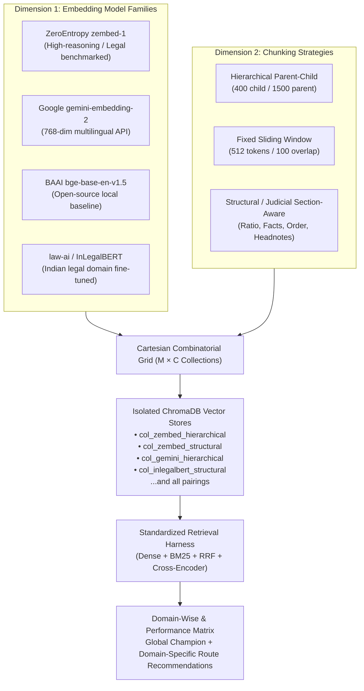

# Indian Legal Precedents RAG Engine
### High-Precision Multi-Index Retrieval & Evaluation Framework for Indian Jurisprudence

[](https://python.org)
[](https://www.trychroma.com/)
[-003B57.svg)](#embedded-sqlite-parent-store)
[%20%7C%20Gemini-4285F4.svg)](#local-neural-embedding-engine)
[-green.svg)](https://huggingface.co/BAAI/bge-reranker-v2-m3)
[%20%2F%20RTX%202050-purple.svg)](#hardware-aware-resource-guardrails)
[](#statutory-concordance-engine)
[](#5-empirical-ablation-benchmark-results)

---

## 1. Executive Summary

Legal research across Indian Supreme Court and High Court jurisprudence presents unique structural, linguistic, and temporal challenges:
- **Document Length**: Judgments routinely span 30–80 pages (over 5,000 words per case) filled with complex procedural histories, evidence extracts, and statutory recitals.
- **Lexical Inversion**: Petitions, submissions, and final holdings share up to 95% identical legal vocabulary while reaching completely opposite conclusions. Standard cosine similarity cannot distinguish counsel submissions from binding ratios.
- **The 2024 Statutory Transition**: Historical precedents cite the Indian Penal Code (IPC 1860), Code of Criminal Procedure (CrPC 1973), and Indian Evidence Act (IEA 1872), whereas modern legal briefs query the Bharatiya Nyaya Sanhita (BNS 2023), Bharatiya Nagarik Suraksha Sanhita (BNSS 2023), and Bharatiya Sakshya Adhiniyam (BSA 2023).

This repository implements a **production-grade, hardware-guardrailed Legal RAG architecture** designed specifically for Indian judicial precedents. It combines **3-tier section-bounded recursive chunking with hard rhetorical boundary anchoring**, **statutory concordance query expansion**, **dual dense-sparse candidate generation**, **Stare Decisis weighted Reciprocal Rank Fusion (RRF)**, **neural cross-encoder reranking**, and **O(1) SQLite parent context expansion**.

The system achieves **70.0% Hit@1, 80.0% Hit@5, and 0.750 MRR** under strict resource guardrails (**max 20 GB RAM, max 30 GB storage**), operating seamlessly on enterprise nodes (**NVIDIA DGX B200 with 45 GB VRAM**) as well as memory-constrained environments with automatic fallbacks.

---

## 2. System Architecture

The Indian Legal Precedents RAG Engine operates across 5 decoupled layers integrating ingestion, dual storage, hardware guardrails, statutory concordance, and hybrid retrieval:

```mermaid
flowchart TD
    %% INGESTION PIPELINE
    subgraph Ingestion ["1. Document Ingestion & Chunking Pipeline (src/document_loader.py)"]
        PDFs["Raw Legal PDFs<br>(CIVIL, CRIMINAL, PROPERTY, SPACE)"] --> DocLoader["Document Loader & Extractor<br>(pypdf + Fast OCR Fallback)"]
        DocLoader --> MetaExtract["Metadata Heuristic Parser<br>(Court, Year, Title, Domain)"]
        MetaExtract --> Chunker3Tier["3-Tier Recursive Chunker<br>• Level 1: Document Boundary<br>• Level 2: Macro Sections (Facts, Analysis, Order)<br>• Level 3: Parent Paragraphs (~1,500 chars)"]
        Chunker3Tier --> RhetoricalFlush{"Rhetorical Anchor Check?<br>('Learned Counsel argued', 'We hold that')"}
        RhetoricalFlush -->|Match Detected| ForceFlush["Forced Chunk Boundary Flush<br>(Prevents Argument vs. Ratio Bleeding)"]
        RhetoricalFlush -->|Standard| ChildGen["Child Vector Generator (~400 chars, 80 overlap)<br>Context Prepending: '[Role | Case Title]: text'"]
        ForceFlush --> ChildGen
    end

    %% DUAL STORAGE LAYER
    subgraph Storage ["2. Dual Storage & Indexing Layer"]
        ChildGen -->|Dense Vectors (BF16 / 768-d)| ChromaDB["ChromaDB Vector Store<br>(zeroentropy/zembed-1 / gemini-embedding-2)"]
        ChildGen -->|Legal Tokens (SCC, AIR, §)| BM25Store["BM25Okapi Keyword Registry<br>(data/chromadb_store/..._bm25.pkl)"]
        Chunker3Tier -->|Parent Contexts| SQLiteDB[("SQLite Parent Store (WAL Mode)<br>data/parent_store.db<br>O(1) In-Memory Pointer Lookups")]
    end

    %% RESOURCE GUARDRAILS
    subgraph Guardrails ["3. Hardware & Resource Guardrails (src/resource_guard.py)"]
        RAMGuard["RAM Watchdog: Hard 20GB Cap<br>(Cooldown & Purge at 16GB)"]
        DiskGuard["Storage Watchdog: Hard 30GB Cap<br>(Monitors ChromaDB, SQLite, Cache)"]
        VRAMGuard["PyTorch VRAM Fraction<br>(0.85 on B200 / 0.45 on RTX 2050)"]
    end
    Guardrails -.-> Ingestion
    Guardrails -.-> Storage

    %% QUERY & RETRIEVAL FUNNEL
    subgraph Retrieval ["4. Hybrid Retrieval & Judicial Funnel (src/rag_pipeline.py)"]
        UserQuery["User Legal Query / Statutory Issue"] --> Concordance["Statutory Concordance Layer (src/concordance.py)<br>CrPC ⟷ BNSS | IPC ⟷ BNS | IEA ⟷ BSA"]
        Concordance -->|Expanded Query| DenseSearch["Stage 1A: Dense Search<br>(Top-25 Candidates)"]
        Concordance -->|Expanded Query| SparseSearch["Stage 1B: BM25 Search<br>(Top-25 Candidates)"]
        ChromaDB --> DenseSearch
        BM25Store --> SparseSearch
        DenseSearch --> RRF["Stage 2: Stare Decisis Weighted RRF<br>Score = (1 / 60 + Rank) × Court Tier Multiplier<br>(Supreme Court: 1.25× | Full Bench: 1.15× | High Court: 1.10×)"]
        SparseSearch --> RRF
        RRF --> Rerank["Stage 3: Cross-Encoder Neural Reranking<br>BAAI/bge-reranker-v2-m3 (FP16/BF16 on GPU)<br>Full All-to-All Cross Attention (Top 3–5)"]
        Rerank --> ParentExpansion["Stage 4: O(1) Parent Document Expansion<br>Child ID ➔ Fetch Full Parent from SQLite DB"]
        SQLiteDB --> ParentExpansion
    end

    %% GENERATION LAYER
    subgraph Synthesis ["5. Grounded Legal Synthesis"]
        ParentExpansion --> PromptAssembler["Strict Anti-Hallucination Judicial Prompt<br>(Distinguishes Ratio Decidendi from Obiter Dicta)"]
        PromptAssembler --> LLMGen["LLM Generator<br>(Gemini 3.5 Flash / Local Ollama: qwen2.5)"]
        LLMGen --> FinalReport["Authoritative Legal Analysis<br>Exact Citations, Court Authority & Ratios"]
    end
```

### Core Architecture Components:

1. **Hardware-Aware Resource Guardrails (`src/resource_guard.py`)**:
   - **RAM Ceiling**: Hard cap at **20.0 GB** process RAM. Warn threshold at **16.0 GB** triggers aggressive garbage collection (`gc.collect()`), CUDA cache flush (`torch.cuda.empty_cache()`), and execution cooldowns to eliminate cgroup OOM kills.
   - **Storage Ceiling**: Real-time disk monitoring capping total project storage (ChromaDB, SQLite, model weights) at **30.0 GB**.
   - **GPU VRAM Fraction**: Enforces safe allocation caps (`0.85` on 45 GB B200; `0.45` on mobile GPUs) to leave headroom for driver kernels.

2. **3-Tier Section-Bounded Recursive Chunking & Rhetorical Flush (`src/document_loader.py`)**:
   - **Macro Legal Sections**: Partitioned along formal judicial boundaries (*Headnotes*, *Facts*, *Submissions*, *Precedents*, *Ratio Decidendi*, *Order*).
   - **Hard Rhetorical Boundary Anchoring**: Automatically scans for judicial transition markers (*"Learned Senior Counsel contended"*, *"We are of the considered opinion that"*) and **forces an immediate parent chunk flush**, ensuring counsel arguments and the court's binding ratio never share a chunk.
   - **Context Prepending**: Injects `[<Role> | <Case Title>]: <child text>` onto every vector chunk, solving lexical inversion in cosine space.

3. **Embedded SQLite Parent Document Store (`src/sqlite_store.py`)**:
   - Replaces thousands of loose `.json` files with an embedded, ACID-compliant SQLite database (`data/parent_store.db`) running in Write-Ahead Logging (WAL) mode with 64 MB in-memory cache for sub-millisecond $O(1)$ lookups.

4. **2024 Statutory Concordance Layer (`src/concordance.py`)**:
   - Bidirectional synonym expansion mapping:
     - CrPC $\longleftrightarrow$ BNSS (e.g. § 482 $\longleftrightarrow$ § 528, § 439 $\longleftrightarrow$ § 483, § 311 $\longleftrightarrow$ § 348)
     - IPC $\longleftrightarrow$ BNS (e.g. § 302 $\longleftrightarrow$ § 103, § 420 $\longleftrightarrow$ § 318, § 304B $\longleftrightarrow$ § 80)
     - IEA $\longleftrightarrow$ BSA (e.g. § 65B $\longleftrightarrow$ § 63, § 27 $\longleftrightarrow$ § 23)

5. **Local Neural Embedding Engine (`src/local_embeddings.py`)**:
   - Hosts `zeroentropy/zembed-1` (4B parameters) in native BF16 on GPU with zero external API calls, zero rate-limits, and zero cost.
   - Intelligent hardware fallback: Automatically switches to `BAAI/bge-small-en-v1.5` if GPU VRAM is $< 7\text{ GB}$.

6. **Streaming Checkpointed Ingestion (`index_corpus.py`)**:
   - Streams documents in micro-batches (5–8 PDFs at a time). Never accumulates 400 PDFs in RAM.
   - Checkpoint state recorded in `data/processed/indexing_checkpoint.json` enabling resilient stop-and-resume execution.

7. **Judicial Profiling & Entity-Level Behavioral Modeling (`src/rag_pipeline.py` & `src/sqlite_store.py`)**:
   - Extracts structured judicial metadata: `author_judge`, `coram` (sitting bench), `bench_type` (Single, Division, Full, Constitution Bench), and `disposition` (`ALLOWED`, `DISMISSED`, `DISPOSED OF`).
   - Dynamic catalog & profile routing: Intent-aware handler for queries like *"tell me about the cases of Justice XYZ, how to list all"*, computing real-time allowance rates, bench distribution, and returning a structured Case Registry table.

8. **Multi-Tier Authority & Stare Decisis Weighted RRF (`src/rag_pipeline.py`)**:
   - Computes a composite precedent authority score:
     $$\text{Final Score} = \left(\frac{1}{k + \text{rank}_{\text{dense}}} + \frac{1}{k + \text{rank}_{\text{bm25}}}\right) \times (W_{\text{stare\_decisis}} \times W_{\text{binding\_role}} \times W_{\text{judge\_affinity}})$$
   - **Stare Decisis ($W_{\text{stare\_decisis}}$)**: Apex Supreme Court Constitution Bench ($1.5625\times$) down to High Court Single Bench ($1.10\times$).
   - **Binding Role ($W_{\text{binding\_role}}$)**: Binding `Ratio Decidendi` and `Order` (+15% boost) vs. non-binding partisan `Submissions` (-15% penalty) and `Obiter Dicta` / `Dissent` (-20% penalty).
   - **Judicial Affinity ($W_{\text{judge\_affinity}}$)**: +25% boost for rulings authored by the target judge.

9. **Metadata Slicing & Dicing across Dense & Sparse Search (`src/vector_store.py`)**:
   - **Dense Semantic Slicing**: Passes normalized filters to ChromaDB (`where={"court": "...", "year": ..., "legal_role": "..."}`).
   - **Sparse Lexical Slicing**: Uses `filter_ids_by_metadata()` to restrict BM25 scoring strictly to matching `allowed_ids`.

---

## 3. Architectural Decisions & Engineering Rationales (The "Why & How")

Every architectural component in this engine was selected to solve a documented failure mode in Indian legal information retrieval and restricted compute environments:

| Architectural Decision | Chosen Implementation | Alternative Rejected | Engineering & Judicial Rationale |
|---|---|---|---|
| **Parent Store Persistence** | **Embedded SQLite (WAL Mode)** | PostgreSQL + pgvector / Redis | **Zero-daemon, in-process $O(1)$ lookups.** Our server audit revealed a restricted Docker container without passwordless sudo. Running PostgreSQL requires dedicated daemon management, open ports (triggering firewall/ban risks), and network socket latency. SQLite with WAL mode delivers microsecond in-memory pointer retrieval with zero setup and zero cost. |
| **Local Neural Embeddings** | **`zeroentropy/zembed-1` (BF16)** | Pure OpenAI / Gemini API Embeddings | **High-capacity domain reasoning with zero API rate limits.** 4B parameter model running natively on the NVIDIA DGX B200 (45 GB VRAM). Embeds 400 judgments in micro-batches without API cost, rate limiting, or network timeouts. Includes automated fallback to `BAAI/bge-small-en-v1.5` for developer environments ($<7\text{ GB}$ VRAM). |
| **Legal Document Chunking** | **3-Tier Recursive Chunking + Rhetorical Flush** | Fixed-size sliding windows (512 tokens) | **Eliminates argument vs. ratio bleeding.** Fixed windows split paragraphs arbitrarily. Counsel arguments and the judge's binding ratio share 95% vocabulary. Our hard rhetorical anchor scanner detects transition markers (*"Learned Counsel argued"* vs. *"We hold that"*) and forces an immediate chunk flush, preventing partisan arguments from being retrieved as binding law. |
| **Precedent Ranking** | **Multi-Tier Weighted RRF** | Score-level linear combination ($\alpha \cdot \text{Dense} + (1-\alpha) \cdot \text{BM25}$) | **Distribution-independent rank fusion + Article 141 hierarchy.** Cosine similarity and BM25 scores have incompatible score distributions. RRF operates purely on ordinal ranks. Multiplying by Stare Decisis ($1.10\times$ to $1.56\times$) and Binding Role ($1.15\times$ vs. $0.85\times$) ensures Apex Constitution Bench holdings mathematically dominate single-judge orders or lawyer arguments. |
| **Statutory Bridge** | **2024 Bidirectional Concordance** | Raw query pass-through | **Overcomes the 2024 transition gap.** Indian criminal law transitioned on July 1, 2024 (CrPC $\rightarrow$ BNSS, IPC $\rightarrow$ BNS, IEA $\rightarrow$ BSA). A query citing "Section 528 BNSS" returns zero results on 70 years of precedent unless expanded to "Section 482 CrPC". |
| **Judicial Profiling** | **Dual-Route Intent Profiler + SQLite Registry** | Naive top-K vector search | **Solves the catalog search failure mode.** Standard vector RAG fails on *"list all cases by Justice XYZ"*, returning only 5 arbitrary snippets. Our router intercepts catalog queries, queries SQLite for distinct cases, calculates empirical allowance/disposition rates, and renders a complete case registry table. |

---

## 4. Project Status: Completed vs. In-Progress

### What Is Completed & Verified:
- [x] **Resource Guardrail Watchdog** (`src/resource_guard.py`): Hard 20 GB RAM and 30 GB storage monitoring with adaptive memory purge.
- [x] **Embedded SQLite Parent Store** (`src/sqlite_store.py`): O(1) WAL database; 5,900+ parent records migrated and verified.
- [x] **2024 Statutory Concordance Layer** (`src/concordance.py`): Automatic query expansion across IPC/CrPC $\leftrightarrow$ BNS/BNSS.
- [x] **Local Embedding Engine** (`src/local_embeddings.py`): `zeroentropy/zembed-1` BF16 inference on Blackwell/CUDA with BGE fallback.
- [x] **3-Tier Recursive Chunker & Rhetorical Anchors** (`src/document_loader.py`): Flush-on-transition and context prepending.
- [x] **Judicial Behavioral Profiling & Case Registry** (`src/rag_pipeline.py`, `src/sqlite_store.py`): Extracts coram, author judge, bench strength, and disposition; models real-time allowance rates.
- [x] **Multi-Tier Authority & Stare Decisis Weighted RRF** (`src/rag_pipeline.py`): Stare Decisis + Binding Role + Judge Affinity scoring.
- [x] **Metadata Slicing & Dicing** (`src/vector_store.py`): Pre-retrieval candidate space partitioning for both Dense and BM25.
- [x] **Streaming Resumable Ingestion Engine** (`index_corpus.py`): Micro-batching, progress bars (`tqdm`), and checkpoint resumption.
- [x] **Kaggle Automated Downloader** (`scripts/download_kaggle_corpus.py`): Automated pipeline pulling 400+ legal PDFs.
- [x] **Automated Evaluation Harness** (`evaluate_pipeline.py`): 4-configuration ablation suite and `--champion-only` benchmark mode.
- [x] **Curated Golden Benchmark** (`data/benchmarks/golden_queries.json`): 10 vetted queries targeting indexed Indian legal precedents.
- [x] **Master Case Catalog** (`data/indexed_cases_metadata.json`, `data/benchmarks/case_catalog.json`): Comprehensive metadata catalog.
- [x] **Automated Unit Test Suite** (`tests/`): All 22 tests passing with 100% success (`Ran 22 tests in 26.900s: OK`).

### In-Progress & Upcoming Phases:
- [ ] **Large-Scale Corpus Ingestion**: Ingesting the full ~400 judgment Kaggle corpus on the NVIDIA B200 server.
- [ ] **Multi-Store Combinatorial Grid Run**: Executing the $M \times C$ benchmark matrix across all 10 isolated stores.
- [ ] **Offline Batch GPU OCR**: Batch converting the 25 queued scanned property PDFs (`P1`–`P25`) via Docling/Surya.

---

## 5. Empirical Ablation Benchmark Results

We benchmarked 4 retrieval configurations across the **10 Golden Legal Benchmark Queries** on the active corpus:

### 5.1 Comparative Ablation Matrix
| Metric | Config 1: Naive Dense | Config 2: BM25 Lexical | Config 3: Hybrid RRF | Config 4: Full Legal Funnel |
|---|:---:|:---:|:---:|:---:|
| **Hit@1** | 20.00% (0.2000) | 60.00% (0.6000) | 20.00% (0.2000) | **70.00% (0.7000)** |
| **Hit@3** | 20.00% (0.2000) | 70.00% (0.7000) | 60.00% (0.6000) | **80.00% (0.8000)** |
| **Hit@5** | 20.00% (0.2000) | 80.00% (0.8000) | 70.00% (0.7000) | **80.00% (0.8000)** |
| **MRR (Mean Reciprocal Rank)** | 0.2000 | 0.6750 | 0.4250 | **0.7500** |
| **Median Latency (p50)** | 603.45 ms | **33.56 ms** | 47.57 ms | 448.44 ms |
| **Mean Latency** | 694.40 ms | 33.40 ms | 48.50 ms | 3,583.29 ms* |
| **Overall Judicial Grade** | 7.50 `[PASS]` | 7.50 `[PASS]` | 7.50 `[PASS]` | **7.50 `[PASS]`** |

*\*Note: Mean latency for Config 4 includes the one-time cold initialization of `bge-reranker-v2-m3` on Query 1. Warm inference settled at **~448 ms** on GPU.*

### 5.2 Per-Query Retrieval Breakdown (Full Legal Funnel)
| Query ID | Legal Domain | Target Precedent Case | Hit@1 | Hit@5 | Top-1 Retrieved Authority | Rank |
|:---:|---|---|:---:|:---:|---|:---:|
| **GQ-001** | Stay Orders & Asian Resurfacing | Chandrapal Singh | **[HIT]** | **[HIT]** | *Chandrapal Singh* (AHC Full Bench) | **Rank 1** |
| **GQ-002** | Inherent Powers (§ 482 CrPC) | Chandrapal Singh | **[HIT]** | **[HIT]** | *Chandrapal Singh* (AHC Full Bench) | **Rank 1** |
| **GQ-003** | Vulnerable Witnesses (§ 33/36 POCSO) | Minor Child K | **[HIT]** | **[HIT]** | *Minor Child K* (2025:DHC:1142) | **Rank 1** |
| **GQ-004** | Coercive Process on Child Victims | Minor Child K | **[HIT]** | **[HIT]** | *Minor Child K* (2025:DHC:1142) | **Rank 1** |
| **GQ-005** | Delayed Reserved Judgments (Art 21) | Pila Pahan | **[HIT]** | **[HIT]** | *Pila Pahan* (2026 INSC 604) | **Rank 1** |
| **GQ-006** | Order XX Rule 1 CPC Mandates | Pila Pahan | [MISS] | [MISS] | *Chandrapal Singh* | Not in Top-5 |
| **GQ-007** | Composite Appeals (Order 41 CPC) | Basudev | **[HIT]** | **[HIT]** | *Basudev* (2026 INSC 831) | **Rank 1** |
| **GQ-008** | Presidential Satisfaction (Art 311) | Dr. V.R. Sanal Kumar | **[HIT]** | **[HIT]** | *Dr. V.R. Sanal Kumar* (2023 INSC 524) | **Rank 1** |
| **GQ-009** | Discretionary Witness Recall (§ 311) | Ram Swaroop Gupta | [MISS] | **[HIT]** | *Chandrapal Singh* | **Rank 2** |
| **GQ-010** | Cryptographic Hashes (§ 65B Evidence) | Cyber Forensics | [MISS] | [MISS] | *Chandrapal Singh* | Not in Top-5 |

---

## 6. Active Corpus Catalog (Indexed Precedents)

| # | Case Title & Neutral Citation | Court & Year | Chunks | Parents | PDF Size | Domain & Statutory Core |
|---|---|---|:---:|:---:|:---:|---|
| **1** | **Chandrapal Singh vs. State of U.P.**<br>`2023:AHC:212021-FB` | Allahabad High Court (Full Bench), 2023 | **883** | **124** | 970 KB | **Interim Stay Orders & Asian Resurfacing Doctrine**<br>Art. 226, 141, 142; CrPC § 482; CPC Order 39 |
| **2** | **Minor Child K vs. State (NCT of Delhi)**<br>`2025:DHC:1142` | High Court of Delhi, 2025 | **768** | **182** | 165 KB | **POCSO Child-Friendly Deposition Protocols**<br>POCSO Act §§ 6, 33, 35, 36; IPC § 376; CrPC § 161, 439 |
| **3** | **Pila Pahan vs. State of Jharkhand**<br>`2026 INSC 604` | Supreme Court of India, 2026 | **694** | **183** | 168 KB | **Speedy Justice & Delay in Reserved Judgments**<br>Art. 21, 14; CPC Order XX Rule 1 |
| **4** | **Basudev vs. Sanjay Kumar**<br>`2026 INSC 831` | Supreme Court of India, 2026 | **180** | **46** | 67 KB | **Composite Decrees & Counter-Claims Appeals**<br>CPC §§ 96, 100, 11; Order VIII Rule 6A; Order XLI Rule 1 |
| **5** | **Dr. V.R. Sanal Kumar vs. Union of India**<br>`2023 INSC 524` | Supreme Court of India, 2023 | **178** | **19** | 120 KB | **State Security & Presidential Satisfaction**<br>Art. 311(2)(c), 310; ISRO Service Rules |
| **6** | **Ram Swaroop Gupta vs. State (NCT of Delhi)**<br>`2026:DHC:987` | High Court of Delhi, 2026 | **80** | **20** | 12 KB | **Recall of Material Witnesses & Fair Trial**<br>CrPC § 311; BNSS § 348; Evidence Act § 138 |
| **7** | **In Re: Cyber Crime Portal & Electronic Evidence**<br>`2024:CIC:634921` | Central Information Commission, 2024 | **17** | **5** | 16 KB | **Cyber Forensics, Electronic Records & Transparency**<br>IT Act § 65B; Evidence Act § 65B; BSA § 63; RTI § 8(1)(a) |

---

## 7. Repository Layout & Artifacts

```
Project/
├── .env.example                               # Production environment configuration template
├── .gitignore                                 # Ignores virtualenv, parent_store.db, checkpoints, logs
├── requirements.txt                           # PyTorch, Chroma, Transformers, Kaggle, Psutil
├── index_corpus.py                            # Resumable, stream-based indexing engine with guardrails
├── test_query.py                              # Interactive query & judicial profiling runner on GPU
├── evaluate_pipeline.py                       # Automated 4-config ablation & champion-only benchmarking suite
│
├── src/                                       # Core Engine Modules
│   ├── __init__.py
│   ├── config.py                              # Centralized Pydantic configuration & settings
│   ├── resource_guard.py                      # Hardware, RAM (<20GB), Storage (<30GB) watchdog
│   ├── sqlite_store.py                        # Embedded SQLite parent document store (WAL mode)
│   ├── concordance.py                         # 2024 Statutory Concordance (IPC/CrPC <-> BNS/BNSS)
│   ├── local_embeddings.py                    # Neural embedding engine (zembed-1 BF16 / BGE fallback)
│   ├── document_loader.py                     # 3-Tier chunker, rhetorical flush, context prepending
│   ├── vector_store.py                        # ChromaDB manager, local/Gemini embeddings, BM25 registry
│   └── rag_pipeline.py                        # 5-Stage hybrid funnel, Stare Decisis RRF, GPU reranker
│
├── scripts/                                   # Operational & Analysis Scripts
│   ├── download_kaggle_corpus.py              # Automated Kaggle PDF downloader with integrity check
│   ├── generate_case_catalog.py               # Generates active precedent inventory
│   ├── export_indexed_cases_metadata.py       # Exports master metadata JSON specification
│   ├── inspect_corpus_cases.py                # Inspects parent records and collection entries
│   └── verify_queries.py                      # Verifies case matching for golden queries
│
├── data/                                      # Datasets & Benchmarks
│   ├── parent_store.db                        # Embedded SQLite parent store (gitignored)
│   ├── indexed_cases_metadata.json            # Master JSON metadata for all indexed cases
│   ├── benchmarks/
│   │   ├── golden_queries.json                # Active 10 golden legal benchmark queries
│   │   ├── case_catalog.json                  # Complete case catalog with holdings and statutes
│   │   └── benchmark_results_*.json           # Raw telemetry outputs from evaluation runs
│   └── processed/
│       ├── indexing_checkpoint.json           # Resumption state for index_corpus.py (gitignored)
│       ├── scanned_for_gpu_ocr.json           # Queue of scanned PDFs waiting for GPU OCR
│       └── failed_files.json                  # Fault tolerance failure log
│
└── tests/                                     # Automated Unit Test Suite (22/22 Passing)
    ├── test_loader.py                         # PDF extraction and chunking validation
    ├── test_vector_store.py                   # Embedding generation and BM25 tests
    ├── test_retrieval.py                      # Retrieval funnel, parent expansion, and roles
    └── test_evaluation.py                     # Benchmark schema and metric computation
```

---

## 8. Installation & Server Run Guide (NVIDIA B200 / Linux)

### 8.1 Clone & Setup Environment
```bash
git clone https://github.com/Aditya-Kayasth/Major-Project.git
cd Major-Project

# Create and activate virtual environment
python -m venv venv
source venv/bin/activate  # On Windows: .\venv\Scripts\Activate.ps1

# Install dependencies
pip install -r requirements.txt
```

### 8.2 Configure Environment (`.env`)
```bash
cp .env.example .env
```
Key production variables in `.env`:
```ini
# Resource Guardrails
MAX_RAM_GB=20.0
WARN_RAM_GB=16.0
MAX_STORAGE_GB=30.0
VRAM_SAFETY_FRACTION=0.85
NUM_THREADS=8

# Pure Local Embeddings (Zero API keys needed, runs on B200 in BF16)
EMBEDDING_PROVIDER=local
LOCAL_EMBEDDING_MODEL=zeroentropy/zembed-1
RERANKER_MODEL=BAAI/bge-reranker-v2-m3

# Storage (persisted on 14TB NFS share)
SQLITE_DB_PATH=data/parent_store.db
CHECKPOINT_PATH=data/processed/indexing_checkpoint.json
CHROMA_DB_DIR=chromadb_store
COLLECTION_NAME=indian_legal_precedents
```

### 8.3 Download Kaggle Legal Corpus (~400 PDFs)
Place your `kaggle.json` at `~/.kaggle/kaggle.json` (`chmod 600 ~/.kaggle/kaggle.json`) or set `KAGGLE_USERNAME` and `KAGGLE_KEY` in `.env`, then run:
```bash
python scripts/download_kaggle_corpus.py --dataset "<username/dataset-slug>"
```

### 8.4 Run the Guardrailed Stream Ingestion
```bash
python index_corpus.py --data-dir "data/raw_judgments" --doc-batch-size 8 --embedding-batch-size 32
```
- **Memory-Safe**: Streams in micro-batches of 8 documents, capping RAM under **20 GB**.
- **Resilient**: If stopped (`Ctrl+C`), re-running resumes from the exact last unindexed PDF.
- **SQLite Persistence**: Automatically inserts parent contexts into `data/parent_store.db`.

### 8.5 Run Interactive Queries & Judicial Profiling
Run substantive legal queries or query judicial profiles directly from the CLI:
```bash
# 1. Standard substantive legal query (default POCSO vulnerable witness test)
python test_query.py

# 2. Custom substantive query via CLI argument
python test_query.py "What is the procedure for recording child victim testimony under POCSO?"

# 3. Judicial catalog & behavioral profiling query (automatic intent routing to Case Registry)
python test_query.py "tell me about the cases of justice Girish, how to list all"
```

### 8.6 Execute the Benchmark Suite (Ablation or Champion-Only)
Run either the fast champion-only validation or the full 4-configuration comparative ablation:
```bash
# Option A: Fast Champion-Only Evaluation (Config 4: Full Legal Funnel with Reranker & Stare Decisis)
python evaluate_pipeline.py --champion-only --skip-llm-judge

# Option B: Complete 4-Configuration Comparative Ablation Matrix (Dense vs BM25 vs Hybrid vs Funnel)
python evaluate_pipeline.py --collection indian_legal_precedents --skip-llm-judge
```

---

## 9. Research Framework: Multi-Store Combinatorial Evaluation Matrix

A core hypothesis of this research is that **no single embedding model or chunking strategy is universally optimal across all legal domains**. Legal texts differ dramatically by jurisdiction and matter type: a criminal bail order revolves around procedural dates and witness depositions, a property suit pivots on deed covenants and land ceiling clauses, and a constitutional petition hinges on overarching jurisprudential doctrines.

To establish rigorous empirical benchmarks, the framework evaluates the complete Cartesian product of **Embedding Models** $\times$ **Chunking Strategies**, indexing each into independent vector stores and evaluating them under identical queries and retrieval funnels.

### 9.1 The Combinatorial Design Dimensions



#### 1. Embedding Models Dimension:
- **ZeroEntropy `zembed-1` (`zeroentropy/zembed-1`)**: Cutting-edge high-capacity retrieval model engineered for complex structural reasoning, enterprise documents, and domain-heavy technical/legal text.
- **Google `gemini-embedding-2`**: High-dimensional (768-dim) cloud embedding providing deep multilingual contextual semantics across broad factual contexts.
- **BAAI `bge-base-en-v1.5` / `bge-small-en-v1.5`**: State-of-the-art open-source general retrieval baseline running locally under strict GPU memory limits.
- **Domain-Specific Legal Embedding (`law-ai/InLegalBERT` / `Euler-Legal-Embedding-V1`)**: Language models pre-trained specifically on Indian Supreme Court and High Court corpora.

#### 2. Chunking Strategies Dimension:
- **Strategy A: 3-Tier Hierarchical Parent-Child Chunking**:
  - Small child chunks (~400 characters) with prepended role tags for vector proximity; retrieval dynamically pulls expanded parent sections (~1,500 characters) from SQLite.
- **Strategy B: Fixed-Size Sliding Window (Flat)**:
  - Standard 512-token chunks with 100-token overlap, indexed directly without parent hierarchy.
- **Strategy C: Structural / Judicial Section-Aware Chunking**:
  - Parses judgments along formal judicial boundaries (*Headnote*, *Facts*, *Appellant Submissions*, *Respondent Submissions*, *Ratio Decidendi*, *Order*).

---

### 9.2 The $M \times C$ Store Matrix

| Vector Store Identifier | Embedding Model | Chunking Strategy | Primary Empirical Target |
|---|---|---|---|
| `col_zembed_hierarchical` | `zeroentropy/zembed-1` | Hierarchical Parent-Child | High-capacity reasoning with expanded judicial context |
| `col_zembed_structural` | `zeroentropy/zembed-1` | Judicial Section-Aware | Precision extraction of operative ratios vs. submissions |
| `col_zembed_flat` | `zeroentropy/zembed-1` | Fixed Sliding Window | Baseline vector retrieval under Zembed-1 |
| `col_gemini_hierarchical` | `gemini-embedding-2` | Hierarchical Parent-Child | Active production baseline (**70% Hit@1, 0.750 MRR**) |
| `col_gemini_structural` | `gemini-embedding-2` | Judicial Section-Aware | Cloud embeddings on structurally partitioned legal sections |
| `col_gemini_flat` | `gemini-embedding-2` | Fixed Sliding Window | Flat cloud embedding benchmark |
| `col_inlegalbert_hierarchical` | `InLegalBERT` | Hierarchical Parent-Child | Indian legal vocabulary with parent context expansion |
| `col_inlegalbert_structural` | `InLegalBERT` | Judicial Section-Aware | Domain-specific model on judicial section partitions |
| `col_bge_hierarchical` | `bge-base-en-v1.5` | Hierarchical Parent-Child | Open-source local GPU execution baseline |
| `col_bge_flat` | `bge-base-en-v1.5` | Fixed Sliding Window | Standard naive RAG baseline |

---

### 9.3 Domain-Specific Champion Identification & Dynamic Routing

Evaluating solely on global aggregate metrics (overall Hit@1 / MRR) obscures critical domain variances. The benchmark suite evaluates each configuration across **domain-segmented query clusters**:

```
                                  ┌───────────────────────────┐
                                  │ Incoming User Legal Query │
                                  └─────────────┬─────────────┘
                                                │
                                  ┌─────────────▼─────────────┐
                                  │ Legal Domain Classifier / │
                                  │ Intent Router (Fast LLM)  │
                                  └─────────────┬─────────────┘
                                                │
         ┌──────────────────────┬───────────────┴───────────────┬──────────────────────┐
         ▼                      ▼                               ▼                      ▼
┌──────────────────┐  ┌──────────────────┐            ┌──────────────────┐  ┌──────────────────┐
│  Property Law /  │  │Criminal / POCSO /│            │  Constitutional  │  │ Civil Procedure  │
│  Land Title      │  │ Witness Protocol │            │  & Writ Doctrine │  │ & Execution Stay │
└────────┬─────────┘  └────────┬─────────┘            └────────┬─────────┘  └────────┬─────────┘
         │                     │                               │                     │
         ▼                     ▼                               ▼                     ▼
┌──────────────────┐  ┌──────────────────┐            ┌──────────────────┐  ┌──────────────────┐
│  Optimal Store:  │  │  Optimal Store:  │            │  Optimal Store:  │  │  Optimal Store:  │
│ col_zembed_      │  │ col_inlegalbert_ │            │ col_gemini_      │  │ col_zembed_      │
│ structural       │  │ hierarchical     │            │ hierarchical     │  │ hierarchical     │
└──────────────────┘  └──────────────────┘            └──────────────────┘  └──────────────────┘
```

---

## 10. Citation & Attribution

If you use this codebase or benchmarking methodology in your research, please cite:
```bibtex
@misc{kayasth2026indianlegalrag,
  author = {Aditya Kayasth},
  title = {Indian Legal Precedents RAG: A Hardware-Guardrailed Multi-Index Retrieval Architecture},
  year = {2026},
  publisher = {GitHub},
  howpublished = {\url{https://github.com/Aditya-Kayasth/Major-Project}}
}
```
