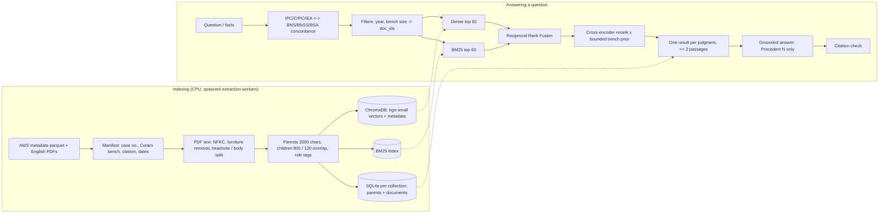

# Supreme Court Criminal Precedents RAG

**A measured, reproducible precedent-retrieval system for Indian criminal law, and a study of which components matter.**

A lawyer types a legal question or the facts of a matter. The system returns ranked Supreme Court of India judgments with:
- the exact passages that matched
- an answer that cites only those judgments
- a citation check on that answer

This is an academic research project (B.E. major project), not a product. It is **not legal advice**.

---

## 1. Problem

Junior lawyers spend hours finding precedents. A practising Mumbai lawyer confirmed that solving the whole problem needs a specialised search engine.

We solve a measurable part of it: **finding the right Supreme Court criminal judgment for a legal issue or a fact pattern, and answering only from it.**

Not claimed: replacing legal research, overruling/treatment tracking, or courts other than the Supreme Court.

## 2. Data

All Supreme Court of India **criminal** judgments (by case number) from **2018–2025**, taken from the AWS Open Data dataset "Indian Supreme Court Judgments" (CC-BY-4.0).

| | |
|---|---|
| Selected (case number contains CRIMINAL / CRL) | 1,891 |
| Indexed (English PDF available) | **1,889** |
| Parent sections / passages | 52,101 / 129,707 |

Selection rule, case types, the author-marker finding, exclusions and gaps: [docs/DATA_CARD.md](docs/DATA_CARD.md). Exploration: [docs/data_exploration.md](docs/data_exploration.md).

## 3. Architecture



| Component | Choice |
|---|---|
| Embeddings | `BAAI/bge-small-en-v1.5` (384-dim, CPU fp32; BGE query instruction on queries only) |
| Reranker | `BAAI/bge-reranker-base` (top 30 passages) |
| Authority prior | Constitution Bench > 3–4 judges > 2 judges > single judge, bounded to ±5% (`AUTHORITY_STRENGTH=0` disables it) |
| Low-confidence refusal | No LLM call if the best relevance is below `MIN_RELEVANCE` (calibrated in §4) |
| Answer LLM / judge | `openai/gpt-oss-120b` via Groq / Gemini (judge only); every call cached |

Nothing is trained or fine-tuned; all models are pretrained.

## 4. Evaluation

> **TODO:** fill every number below from [results/v2/results.json](results/v2/results.json) (produced by `scripts/evaluate_v2.py`). No number may appear here unless that file contains it.

**Benchmark v2** (`scripts/generate_benchmark_v2.py`, seed 42):
- **legal-issue queries:** 100, written from judgment body sections (never from headnotes)
- **fact-pattern queries:** 50
- **out-of-scope queries:** 5
- **human queries:** a template for 20

Queries are stratified by year, and a leakage filter rejects party names, case numbers, citations and dates.

The ground truth is the target judgment's `doc_id`, and ranking is at judgment level with k = 10. The tables report 95% bootstrap CIs (1,000 resamples).

| Configuration | Hit@1 | Hit@3 | Hit@5 | Hit@10 | MRR@10 [95% CI] | nDCG@10 | p50 ms | p95 ms |
|---|---|---|---|---|---|---|---|---|
| Dense | TODO | | | | | | | |
| BM25 | TODO | | | | | | | |
| Hybrid RRF | TODO | | | | | | | |
| Full funnel | TODO | | | | | | | |
| Full without authority prior | TODO | | | | | | | |

- **By query type** (legal issue / fact pattern): TODO, from `results.json` → `configs.*.by_type`.
- **Paired deltas** (Full − no prior, Full − Hybrid, Hybrid − BM25, Hybrid − Dense): TODO.
- **Refusal calibration** (`MIN_RELEVANCE` sweep on out-of-scope vs in-scope queries): TODO.
- **Answer quality** (Gemini judge, 15 queries; citation precision; out-of-scope refusal rate): TODO.

**Benchmark v3 (held-out citations)** checks retrieval against the Court's own citations:
- **Query:** the court-written issue of an **unseen 2026 judgment**, which is not in the index.
- **Relevant judgments:** the precedents that the 2026 Court itself cited, mapped to our corpus by SCR or neutral citation.
- **Scores are lower bounds:** the labels are incomplete, because relevant judgments the Court did not cite count as misses.
- Construction details are in [docs/data_exploration.md](docs/data_exploration.md).

Results: TODO, from `results/v3/results.json`.

The web UI has an **Evaluation** page that draws these charts in the browser from the same `results.json`.

## 5. Demo

1. **Warm the cache:** run `python scripts/run_demo_queries.py`, which answers the five demo queries in [data/demo_queries.json](data/demo_queries.json). Each query is checked against the full index before it is marked `"verified": true`.
2. **Start the web UI:** `nohup python server.py --port 8000 > ~/Pratik/workspace/logs/server.log 2>&1 &`. Never run it at the same time as indexing.
3. **Open it** through the port-forward or tunnel command given in the run instructions.

In the UI each judgment appears as one card. It shows:
- **chips:** citation, date, bench, author, disposal, statutes
- up to two passages, each with its role
- year and bench filters
- a stage-timing line
- the **LOW CONFIDENCE** and citation-check badges

## 6. Running it (server)

```bash
python scripts/download_aws_sc.py --years 2018-2025 --criminal-only --workers 8    # PDFs + manifest
python index_corpus.py --collection sc_criminal_cpu                                 # resumable index
python scripts/generate_benchmark_v2.py --collection sc_criminal_cpu                # benchmark v2 queries
python scripts/evaluate_v2.py --collection sc_criminal_cpu                          # results.json/.md
python -m unittest discover tests                                                   # unit tests
```

## 7. Limitations

- **Small models:** CPU only (no GPU was available), so only small embedding and reranker models are used.
- **Synthetic queries:** they share vocabulary with their source passages, which favours BM25. The human query set is small.
- **Heuristic tags:** role tags are heuristic (about 47% of passages are Unclassified). Statute extraction is regex-based.
- **No overruling detection.**
- **Narrow scope:** Supreme Court criminal judgments 2018–2025 only, English only.
- **Answers:** the answer LLM and the judge LLM come from different providers, but both are automated judgments. Always verify citations on the official source.

## 8. Future work

- A human-written, lawyer-validated query set with graded relevance.
- A GPU run (zembed-1 + bge-reranker-v2-m3) as a separate collection and an extra results row.
- Overruling flags, High Court slices, a learned role classifier, and Qdrant for full-corpus scale.

---

## Earlier experiment (separate, not comparable)

These are numbers from an **earlier GPU run on a different corpus**. They are kept for the record only and are **not comparable** with §4:
- **Corpus:** 400 random 2025 Supreme Court PDFs from Kaggle, 45,000 chunks of 400 characters.
- **Models:** `zeroentropy/zembed-1` on an NVIDIA B200 MIG slice.
- **Benchmark:** 40 synthetic queries, matched by file name.

| Configuration (earlier run) | Hit@1 | Hit@3 | Hit@5 | MRR |
|---|---|---|---|---|
| Naive Dense | 0.325 | 0.375 | 0.450 | 0.369 |
| BM25 | 0.775 | 0.875 | 0.925 | 0.832 |
| Hybrid RRF | 0.425 | 0.750 | 0.875 | 0.587 |
| Full funnel | 0.775 | 0.950 | 1.000 | 0.861 |
