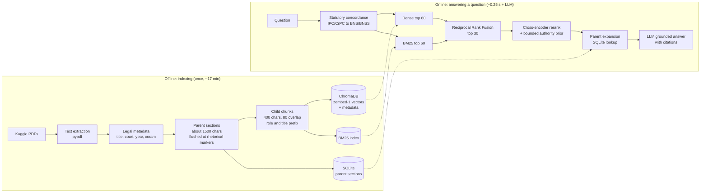

# Indian Legal Precedents RAG

### A precedent-retrieval engine for Indian Supreme Court judgments: hybrid search, legal-aware ranking and grounded answers, evaluated with a reproducible ablation study

-blue)


A lawyer asks a legal question in plain English. The system finds the Supreme Court judgments that actually decided that question, ranks them, shows the exact passages, and writes an answer that cites only those judgments.

---

## 1. Why this is not "just another RAG"

A basic Retrieval-Augmented Generation (RAG) system cuts documents into equal pieces, finds the pieces whose embedding is closest to the question, and pastes them into an LLM prompt. On Indian case law that fails in specific, measurable ways. Each component here exists to fix one of them, and the ablation in Section 5 measures each one.

| Problem with a basic RAG on judgments | What this system does |
|---|---|
| Embeddings capture *topic*, not *the exact case*. Hundreds of judgments discuss bail, so "similar" is not "correct". Dense-only search scores **Hit@1 = 0.325** here. | **Hybrid retrieval**: semantic (dense) search plus keyword (BM25) search, merged with Reciprocal Rank Fusion. |
| Statute numbers, Latin terms and rare facts ("Section 113A", "firing-pin marks") get blurred by embeddings. | **BM25** matches those exact tokens. |
| Fusing two rankings adds noise at the very top (Hit@1 drops to 0.425). | **Cross-encoder reranker** reads the question and each passage *together*, restoring precision (Hit@5 = **1.00**, MRR = **0.861**). |
| Fixed-size chunks mix the lawyer's argument with the court's holding, so the answer can quote an argument the court rejected. | **Legal-aware chunking** flushes section boundaries at rhetorical markers ("Learned counsel submitted…" vs "We hold that…") and tags each chunk with its role. |
| In July 2024 IPC/CrPC/Evidence Act became BNS/BNSS/BSA. A query citing the new section misses every older judgment. | **Statutory concordance**: queries are expanded with the equivalent old/new section numbers. |
| Not all precedent carries equal weight (Article 141). | **Bounded Stare Decisis prior**: court tier and binding role act as a small (±5%) tie-breaker. It never overrides relevance. |
| LLMs invent citations. | **Grounded synthesis**: the LLM only sees retrieved sections with their case metadata, under a zero-hallucination instruction, and the UI shows the source passages beside the answer. |
| "It works" is usually a demo, not a measurement. | **Ablation benchmark** with exact-document ground truth, latency percentiles and an optional LLM judge. |

---

## 2. Headline results

Corpus: **400 Supreme Court of India judgments from 2025** (Kaggle), **45,000 chunks**, **4,807 parent sections**. Benchmark: **40 questions**, each with exactly one correct judgment. Hardware: one NVIDIA B200 MIG 1g.45gb slice.

| Configuration | Hit@1 | Hit@3 | Hit@5 | MRR | Latency p50 | Latency p95 |
|---|:---:|:---:|:---:|:---:|:---:|:---:|
| 1. Naive Dense (embeddings only) | 0.325 | 0.375 | 0.450 | 0.369 | 35 ms | 37 ms |
| 2. BM25 Lexical (keywords only) | 0.775 | 0.875 | 0.925 | 0.832 | 186 ms | 414 ms |
| 3. Hybrid RRF (1 + 2 fused) | 0.425 | 0.750 | 0.875 | 0.587 | 193 ms | 413 ms |
| **4. Full Legal Funnel** (3 + concordance + cross-encoder + authority prior) | **0.775** | **0.950** | **1.000** | **0.861** | 241 ms | 487 ms |

Answer quality of the Full Legal Funnel, scored 0–10 by an LLM judge on 10 questions: **groundedness 7.45, ratio decidendi 7.65, statutory concordance 6.95, reasoning 7.30, overall 7.35**.

**How to read this.** Dense search finds the right *area of law* but rarely the right *judgment*. BM25 is strong because legal questions contain rare, precise terms. Naively fusing the two raises recall (Hit@5 0.45 → 0.875) but adds noise at rank 1. The cross-encoder fixes the ordering: the correct judgment is in the top 5 for **every** question. Two identical runs produced identical retrieval numbers (the pipeline is deterministic).

Limitations are stated in Section 5.4.

---

## 3. Architecture



---

## 4. How it works, step by step

### 4.1 Indexing a judgment

1. **Text extraction.** `pypdf` reads the PDF. Scanned PDFs with no text layer are skipped and logged (0 of 400 here).
2. **Metadata.** Case title comes from the Indian Kanoon file name (`<Party A>_vs_<Party B>_on_<date>.pdf`). Court, year, coram, author judge, bench type and disposition come from regex heuristics over the first and last pages.
3. **Parent sections (~1,500 characters).** Paragraphs are accumulated into sections. A new section is forced whenever a *rhetorical marker* appears, such as "Learned counsel for the appellant submitted…", "We are of the opinion that…" or "In the result…". This keeps a lawyer's argument and the court's holding in different sections.
4. **Child chunks (400 characters, 80 overlap).** Each section is cut into small overlapping windows. Small chunks give precise matching; the parent provides context later.
5. **Role tag and breadcrumb.** Each child is tagged Ratio Decidendi / Facts / Submissions / Precedents Cited / Order by keyword cues. The text that gets embedded is prefixed with `[<role> | <case title>]: `, so the vector "knows" which case it belongs to.
6. **Deterministic IDs.** `chunk_id = sha1(file name)[:16]-p<section>-c<chunk>`. Re-indexing the same file overwrites instead of duplicating.
7. **Three stores are written:**
   - **ChromaDB**: one record per child chunk (vector + text + metadata).
   - **BM25 index**: a keyword index over the same chunk texts, built once at the end of the run.
   - **SQLite**: one row per parent section (full text + document-level metadata).

### 4.2 What is actually stored

You can print a real stored record with `python scripts/explain_query.py --show-record`. A ChromaDB record has this shape (illustrative ID, text shortened):

```text
id        : 3f9a1c0d2e7b6a45-p00031-c002
document  : [Obiter Dicta | Mohd Tahir Hussain vs State Of Nct Of Delhi 1]: 10.2. Imposing any bail condition
            which enables the Police/ Investigation Agency to track every movement of the accused ...
embedding : 2,560 numbers produced by zeroentropy/zembed-1 (cosine space)
metadata  : {
  "parent_id":   "3f9a1c0d2e7b6a45-p00031",   <- link to the parent section in SQLite
  "case_title":  "Mohd Tahir Hussain vs State Of Nct Of Delhi 1",   <- trailing " 1" = Kaggle duplicate-file suffix, hidden in the UI
  "court":       "Supreme Court of India",
  "year":        2025,
  "role":        "Obiter Dicta",               <- heuristic tag ("Unclassified" in the UI when no cue matched)
  "source_path": ".../sc_2025/Mohd_Tahir_Hussain_vs_State_Of_Nct_Of_Delhi_on_..._2025.pdf",
  "parent_index": 31,
  "raw_text":    "10.2. Imposing any bail condition ...",   <- clean snippet for the UI
  "char_length": 452, "raw_char_length": 400
}
```

| Store | One entry per | Holds | Used for |
|---|---|---|---|
| ChromaDB (`chromadb_store/`) | child chunk (45,000) | vector, embedded text, metadata above | dense search, metadata filters, citations |
| BM25 (`chromadb_store/*_bm25.pkl`) | child chunk | tokenised text | keyword search |
| SQLite (`data/parent_store.db`) | parent section (4,807) | full section text, case title, court, year, bench, coram, disposition | context for the LLM, judge profiles |

**How a chunk knows its document:** every chunk's metadata carries `source_path` and `case_title`, and its `parent_id` points to the section it was cut from. Evaluation matches on the source file name, so "correct" means *exactly the right judgment*.

### 4.3 Answering a question

| Stage | What happens | Detail |
|---|---|---|
| 0. Concordance | Old and new statute numbers are appended | "Section 311 CrPC" → "… (statutory concordance: Section 348 BNSS)" |
| 1. Filters (optional) | Restrict by court / year / role | ChromaDB `where` filters |
| 2a. Dense search | Question embedded with zembed-1's **query** prompt; 60 nearest chunks by cosine similarity | Chunks were embedded with the **document** prompt (asymmetric retrieval) |
| 2b. BM25 search | Question tokenised; 60 best chunks by BM25 term statistics | Rewards rare exact terms |
| 3. Rank fusion | `score = Σ 1/(60 + rank)` over both lists, times the authority factor; top 30 kept | Uses ranks only, so the two incompatible score scales never need calibrating |
| 4. Rerank | `BAAI/bge-reranker-v2-m3` scores each (question, chunk) pair jointly; `sigmoid(score) × authority factor` | Authority factor = `1 + clamp(0.1·ln w, ±0.05)`, where `w` = court weight (SC 1.25, HC 1.10) × role weight (holding 1.15 … unclassified 0.80) |
| 5. Parent expansion | Each top chunk's `parent_id` → full ~1,500-char section from SQLite, de-duplicated | Small chunks for matching, big sections for reading |
| 6. Synthesis | LLM receives the question + numbered sections, each headed by case title, court, year, bench and role | System prompt: answer only from context, separate ratio from obiter, give IPC↔BNS concordance, say "insufficient precedent" otherwise |

### 4.4 How citations work

The LLM never searches by itself. It receives each retrieved section under a header built from stored metadata, for example `### [Precedent 2] Mohd Tahir Hussain vs State Of Nct Of Delhi (Supreme Court of India, 2025)`, and is instructed to cite only those. The web UI shows the ranked judgments and their matched passages next to the answer, so every citation can be checked against its source. Automatic verification of each citation is listed under future work.

### 4.5 Which models do what

| Job | Model | Where it runs |
|---|---|---|
| Embeddings | `zeroentropy/zembed-1` (4B, 2,560-dim, BF16) | Local GPU |
| Reranking | `BAAI/bge-reranker-v2-m3` (FP16) | Local GPU |
| Answers, judging, benchmark questions | `openai/gpt-oss-120b` via Groq (OpenAI-compatible API) | API, with automatic fallback to `qwen/qwen3.8-27b`, `openai/gpt-oss-20b`, then Gemini |

Retrieval (stages 0–5) is entirely local and needs no API key.

---

## 5. Evaluation methodology

### 5.1 The benchmark

`scripts/generate_synthetic_queries.py` builds a **known-item** benchmark (the InPars / Promptagator approach):

1. Sample 40 judgments with a fixed seed (42).
2. From each, take the section that most resembles the court's holding (cue phrases such as "we hold", "held that").
3. Ask the LLM for one question a lawyer would type that this section answers, **without** party names, judge names, citations or dates.
4. Reject any question that still contains a party-name word (5 rejected in this run).
5. Store the exact `target_doc_stem` (file name) as ground truth.

### 5.2 Metrics

| Metric | Meaning |
|---|---|
| **Hit@k** | Share of questions whose correct judgment appears in the top *k* results |
| **MRR** (Mean Reciprocal Rank) | Average of 1/rank of the correct judgment (1.0 if always first, 0.5 if always second, 0 if not in top 5) |
| **Latency mean / p50 / p95** | Average, median and 95th-percentile retrieval time, measured after model warm-up |
| **Groundedness** | Does the answer stick to the retrieved judgments, without invented cases or sections? |
| **Ratio decidendi** | Does it separate the binding holding from passing remarks? |
| **Statutory concordance** | Are sections cited correctly, with IPC↔BNS mapping where relevant? |
| **Reasoning quality** | Is the legal reasoning from facts to holding sound? |

Judge scores are reported as **N/A** when not computed; placeholder values are never averaged in.

### 5.3 The four configurations

Each configuration adds one component, so differences can be attributed to that component:

1. **Naive Dense**: ChromaDB cosine search only.
2. **BM25 Lexical**: keyword search only.
3. **Hybrid RRF**: dense + BM25 fused by rank.
4. **Full Legal Funnel**: hybrid + statutory concordance + cross-encoder + bounded authority prior + parent expansion.

### 5.4 Limitations (stated up front)

- **Synthetic questions share vocabulary with their source passage**, which favours BM25. Human-written questions are the next step; the generated questions carry a `verified` flag for manual review.
- **40 questions** give roughly ±13 percentage points of uncertainty on Hit@1 at 95% confidence.
- **The judge is from the same model family as the answer generator** (gpt-oss), which can bias scores upward; scores cover 10 questions.
- **One year of judgments** (2025, 400 documents).
- **Role and bench tags are regex heuristics.** When no cue matches, a chunk is stored as "Obiter Dicta" and shown as "Unclassified" in the UI. Bench type defaults to "Single Bench" when the coram cannot be parsed.

---

## 6. Engineering under real constraints

- **Shared GPU slice (B200 MIG 1g.45gb), ~30 GB usable RAM, NFS storage, no sudo.** A resource guard enforces RAM, VRAM and storage ceilings and halts indexing safely if exceeded. Peak use: about 7.6 GB VRAM and under 3 GB RAM.
- **Resumable, idempotent indexing.** Checkpointed micro-batches of 8 PDFs and deterministic chunk IDs. The BM25 index is built once per run instead of after every batch.
- **cuDNN fails to initialise on the MIG slice.** Attention is routed to PyTorch's flash/memory-efficient kernels instead (`CUDNN_ENABLED=false`), with identical outputs.
- **Free-tier LLM APIs.** `src/llm_budget.py` routes every LLM call through a provider chain (Groq models → Gemini → optional local model). It honours `retry-after`, shrinks oversized requests, switches models when one is rate-limited, and caches every response on disk, so re-running a benchmark costs nothing.

---

## 7. Repository layout

```
├── index_corpus.py                  # Stream indexing with checkpoints and resource guard
├── evaluate_pipeline.py             # 4-configuration ablation + optional LLM judge
├── server.py                        # FastAPI backend for the web demo
├── web/                             # index.html, style.css, app.js (no build step)
├── src/
│   ├── config.py                    # All settings (.env)
│   ├── document_loader.py           # PDF text, legal metadata, parent/child chunking
│   ├── local_embeddings.py          # zembed-1 / BGE embeddings (query vs document prompts)
│   ├── vector_store.py              # ChromaDB + BM25 registry
│   ├── rag_pipeline.py              # Retrieval funnel, authority prior, grounded synthesis
│   ├── concordance.py               # IPC/CrPC/IEA <-> BNS/BNSS/BSA mapping
│   ├── llm_budget.py                # LLM provider chain, rate limits, cache
│   ├── local_llm.py                 # Optional local open-weights LLM
│   ├── sqlite_store.py              # Parent section store
│   └── resource_guard.py            # RAM / VRAM / storage guardrails, cuDNN switch
├── scripts/
│   ├── setup_server.sh              # venv on top of the server's preinstalled libraries
│   ├── download_kaggle_corpus.py    # Download dataset, keep only selected year folders
│   ├── smoke_test.py                # Pre-flight check of every component
│   ├── generate_synthetic_queries.py
│   └── explain_query.py             # Print a stored record / trace a query through the funnel
├── tests/                           # Unit tests (unittest)
└── data/                            # raw_judgments/, processed/, benchmarks/ (corpus is gitignored)
```

---

## 8. Running it on the server

```bash
# 1. Code and environment (reuses the server's PyTorch/Transformers; installs only what is missing, into ./venv)
git clone https://github.com/Aditya-Kayasth/Major-Project.git ~/adkmajorproject && cd ~/adkmajorproject
bash scripts/setup_server.sh && source venv/bin/activate
nano .env          # set LLM_API_KEY (Groq) and optionally GEMINI_API_KEY

# 2. Data: downloads the Kaggle dataset once (no per-folder download exists), keeps only 2025
python scripts/download_kaggle_corpus.py --years 2025 --cleanup

# 3. Check every component, then index (~17 min for 400 judgments)
python scripts/smoke_test.py --llm
nohup python index_corpus.py --data-dir data/raw_judgments --reset > index.log 2>&1 &

# 4. Benchmark: 40 questions, then the ablation (retrieval metrics make no API calls)
python scripts/generate_synthetic_queries.py --num-docs 40
python evaluate_pipeline.py --skip-llm-judge
python evaluate_pipeline.py --judge-limit 10        # optional: adds LLM-judge scores

# 5. Web demo
nohup python server.py --port 8000 > server.log 2>&1 &
~/cloudflared tunnel --url http://localhost:8000    # public https link, or forward port 8000 via a VS Code tunnel
```

Inspect the internals at any time:

```bash
python scripts/explain_query.py --show-record                      # one stored chunk + its parent section
python scripts/explain_query.py "Can bail require sharing live GPS location?"   # stage-by-stage trace
```

### Key settings (`.env`)

| Setting | Default | Purpose |
|---|---|---|
| `LOCAL_EMBEDDING_MODEL` | `zeroentropy/zembed-1` | Embedding model |
| `RERANKER_MODEL` | `BAAI/bge-reranker-v2-m3` | Cross-encoder |
| `PARENT_CHUNK_SIZE` / `CHILD_CHUNK_SIZE` / `CHUNK_OVERLAP` | 1500 / 400 / 80 | Chunking (characters) |
| `SYNTHESIS_PROVIDER` | `openai` | `openai` (any OpenAI-compatible API), `gemini` or `local` |
| `LLM_BASE_URL`, `LLM_API_KEY`, `LLM_MODEL` | Groq, –, `openai/gpt-oss-120b` | Primary LLM |
| `LLM_FALLBACK_MODELS` | – | Models tried when the primary is rate-limited |
| `AUTHORITY_STRENGTH` / `AUTHORITY_MAX_BONUS` | 0.1 / 0.05 | Stare Decisis prior; `0` disables it |
| `MAX_RAM_GB` / `VRAM_SAFETY_FRACTION` | 24 / 0.85 | Resource guard |
| `CUDNN_ENABLED` | `false` | Bypass cuDNN on the MIG slice |

---

## 9. Future work

- **Human-written benchmark questions** and lawyer-validated relevance judgments.
- **Embedding × chunking grid**: zembed-1, BGE and InLegalBERT crossed with hierarchical, fixed-window and section-aware chunking, to find the best combination per legal domain.
- **Citation verification**: check every case and section the LLM cites against the retrieved metadata.
- **Learned role classifier** to replace the keyword heuristic for ratio / obiter / submissions.
- **Multi-year corpus** (the Kaggle dataset covers 1950–2025) with a disk-backed vector index.
