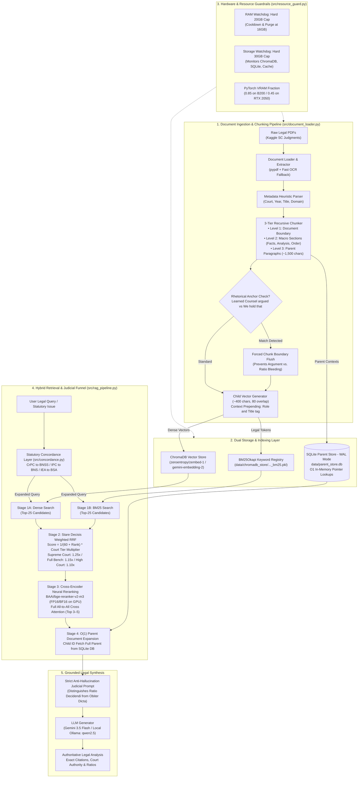

# Indian Legal Precedents RAG Engine
### High-Precision Multi-Index Retrieval & Evaluation Framework for Indian Jurisprudence

[](https://python.org)
[](https://www.trychroma.com/)
[](#2-system-architecture)
[](#2-system-architecture)
[](https://huggingface.co/BAAI/bge-reranker-v2-m3)
[](#2-system-architecture)
[](#2-system-architecture)
[](#6-corpus)

---

## 1. Executive Summary

Legal research across Indian Supreme Court and High Court jurisprudence presents unique structural, linguistic, and temporal challenges:
- **Document Length**: Judgments routinely span 30–80 pages (over 5,000 words per case) filled with complex procedural histories, evidence extracts, and statutory recitals.
- **Lexical Inversion**: Petitions, submissions, and final holdings share up to 95% identical legal vocabulary while reaching completely opposite conclusions. Standard cosine similarity cannot distinguish counsel submissions from binding ratios.
- **The 2024 Statutory Transition**: Historical precedents cite the Indian Penal Code (IPC 1860), Code of Criminal Procedure (CrPC 1973), and Indian Evidence Act (IEA 1872), whereas modern legal briefs query the Bharatiya Nyaya Sanhita (BNS 2023), Bharatiya Nagarik Suraksha Sanhita (BNSS 2023), and Bharatiya Sakshya Adhiniyam (BSA 2023).

This repository implements a **production-grade, hardware-guardrailed Legal RAG architecture** designed specifically for Indian judicial precedents. It combines **3-tier section-bounded recursive chunking with hard rhetorical boundary anchoring**, **statutory concordance query expansion**, **dual dense-sparse candidate generation**, **Stare Decisis weighted Reciprocal Rank Fusion (RRF)**, **neural cross-encoder reranking**, and **O(1) SQLite parent context expansion**.

The system is evaluated with a 4-configuration ablation (dense, BM25, hybrid RRF, full funnel) over Supreme Court of India judgments, under strict resource guardrails (**~30 GB RAM, shared 45 GB GPU slice on an NVIDIA DGX B200**) and the Gemini free tier (rate-limited, budgeted and cached LLM calls).

---

## 2. System Architecture

The Indian Legal Precedents RAG Engine operates across 5 decoupled layers integrating ingestion, dual storage, hardware guardrails, statutory concordance, and hybrid retrieval:



### Core Architecture Components:

1. **Hardware-Aware Resource Guardrails (`src/resource_guard.py`)**:
   - **RAM Ceiling**: Hard cap at **20.0 GB** process RAM. Warn threshold at **16.0 GB** triggers aggressive garbage collection (`gc.collect()`), CUDA cache flush (`torch.cuda.empty_cache()`), and execution cooldowns to eliminate cgroup OOM kills.
   - **Storage Ceiling**: Real-time disk monitoring capping total project storage (ChromaDB, SQLite, model weights) at **30.0 GB**.
   - **GPU VRAM Fraction**: Enforces safe allocation caps (`0.85` on 45 GB B200; `0.45` on mobile GPUs) to leave headroom for driver kernels.

2. **3-Tier Section-Bounded Recursive Chunking & Rhetorical Flush (`src/document_loader.py`)**:
   - **Macro Legal Sections**: Partitioned along formal judicial boundaries (*Headnotes*, *Facts*, *Submissions*, *Precedents*, *Ratio Decidendi*, *Order*).
   - **Hard Rhetorical Boundary Anchoring**: Automatically scans for judicial transition markers (*"Learned Senior Counsel contended"*, *"We are of the considered opinion that"*) and **forces an immediate parent chunk flush**, ensuring counsel arguments and the court's binding ratio never share a chunk.
   - **Context Prepending**: Injects `[<Role> | <Case Title>]: <child text>` onto every vector chunk, solving lexical inversion in cosine space.

3. **Embedded SQLite Parent Document Store (`src/sqlite_store.py`)**:
   - Replaces thousands of loose `.json` files with an embedded, ACID-compliant SQLite database (`data/parent_store.db`) running in Write-Ahead Logging (WAL) mode with 64 MB in-memory cache for sub-millisecond O(1) lookups.

4. **2024 Statutory Concordance Layer (`src/concordance.py`)**:
   - Bidirectional synonym expansion mapping:
     - CrPC <--> BNSS (e.g. § 482 <--> § 528, § 439 <--> § 483, § 311 <--> § 348)
     - IPC <--> BNS (e.g. § 302 <--> § 103, § 420 <--> § 318, § 304B <--> § 80)
     - IEA <--> BSA (e.g. § 65B <--> § 63, § 27 <--> § 23)

5. **Local Neural Embedding Engine (`src/local_embeddings.py`)**:
   - Hosts `zeroentropy/zembed-1` (4B parameters) in native BF16 on GPU with zero external API calls, zero rate-limits, and zero cost.
   - Intelligent hardware fallback: Automatically switches to `BAAI/bge-small-en-v1.5` if GPU VRAM is < 7 GB.

6. **Streaming Checkpointed Ingestion (`index_corpus.py`)**:
   - Streams documents in micro-batches (5–8 PDFs at a time). Never accumulates 400 PDFs in RAM.
   - Checkpoint state recorded in `data/processed/indexing_checkpoint.json` enabling resilient stop-and-resume execution.

7. **Judicial Profiling & Entity-Level Behavioral Modeling (`src/rag_pipeline.py` & `src/sqlite_store.py`)**:
   - Extracts structured judicial metadata: `author_judge`, `coram` (sitting bench), `bench_type` (Single, Division, Full, Constitution Bench), and `disposition` (`ALLOWED`, `DISMISSED`, `DISPOSED OF`).
   - Dynamic catalog & profile routing: Intent-aware handler for queries like *"tell me about the cases of Justice XYZ, how to list all"*, computing real-time allowance rates, bench distribution, and returning a structured Case Registry table.

8. **Multi-Tier Authority & Stare Decisis Weighted RRF (`src/rag_pipeline.py`)**:
   - Computes a composite precedent authority score:

$$
\text{Final Score} = \left(\frac{1}{k + \text{rank(dense)}} + \frac{1}{k + \text{rank(sparse)}}\right) \times (W_{\text{stare-decisis}} \times W_{\text{binding-role}} \times W_{\text{judge-affinity}})
$$

   - **Stare Decisis (`W_stare_decisis`)**: Apex Supreme Court Constitution Bench (1.5625x) down to High Court Single Bench (1.10x).
   - **Binding Role (`W_binding_role`)**: Binding `Ratio Decidendi` and `Order` (+15% boost) vs. non-binding partisan `Submissions` (-15% penalty) and `Obiter Dicta` / `Dissent` (-20% penalty).
   - **Judicial Affinity (`W_judge_affinity`)**: +25% boost for rulings authored by the target judge.

9. **Metadata Slicing & Dicing across Dense & Sparse Search (`src/vector_store.py`)**:
   - **Dense Semantic Slicing**: Passes normalized filters to ChromaDB (`where={"court": "...", "year": ..., "legal_role": "..."}`).
   - **Sparse Lexical Slicing**: Uses `filter_ids_by_metadata()` to restrict BM25 scoring strictly to matching `allowed_ids`.

---

## 3. Architectural Decisions & Engineering Rationales (The "Why & How")

Every architectural component in this engine was selected to solve a documented failure mode in Indian legal information retrieval and restricted compute environments:

| Architectural Decision | Chosen Implementation | Alternative Rejected | Engineering & Judicial Rationale |
|---|---|---|---|
| **Parent Store Persistence** | **Embedded SQLite (WAL Mode)** | PostgreSQL + pgvector / Redis | **Zero-daemon, in-process O(1) lookups.** Our server audit revealed a restricted Docker container without passwordless sudo. Running PostgreSQL requires dedicated daemon management, open ports (triggering firewall/ban risks), and network socket latency. SQLite with WAL mode delivers microsecond in-memory pointer retrieval with zero setup and zero cost. |
| **Local Neural Embeddings** | **`zeroentropy/zembed-1` (BF16)** | Pure OpenAI / Gemini API Embeddings | **High-capacity domain reasoning with zero API rate limits.** 4B parameter model running natively on the NVIDIA DGX B200 (45 GB VRAM). Embeds 400 judgments in micro-batches without API cost, rate limiting, or network timeouts. Includes automated fallback to `BAAI/bge-small-en-v1.5` for developer environments (< 7 GB VRAM). |
| **Legal Document Chunking** | **3-Tier Recursive Chunking + Rhetorical Flush** | Fixed-size sliding windows (512 tokens) | **Eliminates argument vs. ratio bleeding.** Fixed windows split paragraphs arbitrarily. Counsel arguments and the judge's binding ratio share 95% vocabulary. Our hard rhetorical anchor scanner detects transition markers (*"Learned Counsel argued"* vs. *"We hold that"*) and forces an immediate chunk flush, preventing partisan arguments from being retrieved as binding law. |
| **Precedent Ranking** | **Multi-Tier Weighted RRF** | Score-level linear combination (`α * Dense + (1-α) * BM25`) | **Distribution-independent rank fusion + Article 141 hierarchy.** Cosine similarity and BM25 scores have incompatible score distributions. RRF operates purely on ordinal ranks. Stare Decisis (court tier, bench strength) and binding role enter as a **bounded log-scale prior** (`1 + clamp(0.1·ln(w), ±5%)`): it breaks ties in favour of binding, higher-authority holdings without letting a weakly relevant Constitution Bench chunk outrank the relevant one. Set `AUTHORITY_STRENGTH=0` for a pure-relevance ablation. |
| **Statutory Bridge** | **2024 Bidirectional Concordance** | Raw query pass-through | **Overcomes the 2024 transition gap.** Indian criminal law transitioned on July 1, 2024 (CrPC -> BNSS, IPC -> BNS, IEA -> BSA). A query citing "Section 528 BNSS" returns zero results on 70 years of precedent unless expanded to "Section 482 CrPC". |
| **Judicial Profiling** | **Dual-Route Intent Profiler + SQLite Registry** | Naive top-K vector search | **Solves the catalog search failure mode.** Standard vector RAG fails on *"list all cases by Justice XYZ"*, returning only 5 arbitrary snippets. Our router intercepts catalog queries, queries SQLite for distinct cases, calculates empirical allowance/disposition rates, and renders a complete case registry table. |

---

## 4. Project Status: Completed vs. In-Progress

### What Is Completed & Verified:
- [x] **Resource Guardrail Watchdog** (`src/resource_guard.py`): RAM / VRAM / storage monitoring with adaptive memory purge.
- [x] **Embedded SQLite Parent Store** (`src/sqlite_store.py`): O(1) WAL database for parent sections.
- [x] **2024 Statutory Concordance Layer** (`src/concordance.py`): Query expansion across IPC/CrPC/IEA $\leftrightarrow$ BNS/BNSS/BSA.
- [x] **Local Embedding Engine** (`src/local_embeddings.py`): `zeroentropy/zembed-1` BF16 with asymmetric query/document prompts.
- [x] **3-Tier Chunker & Rhetorical Anchors** (`src/document_loader.py`): Flush-on-transition, role tagging, deterministic chunk IDs.
- [x] **Bounded Stare Decisis Prior** (`src/rag_pipeline.py`): Court tier, bench strength and binding role as a ±5% tie-breaker on RRF and cross-encoder scores.
- [x] **Streaming Resumable Ingestion** (`index_corpus.py`): Micro-batching, checkpoints, idempotent re-runs, single BM25 build.
- [x] **Gemini Free-Tier Guard** (`src/llm_budget.py`): RPM limiter, daily request budget, on-disk response cache.
- [x] **Synthetic Known-Item Benchmark** (`scripts/generate_synthetic_queries.py`): Leakage-controlled questions with exact target documents.
- [x] **Evaluation Harness** (`evaluate_pipeline.py`): 4-configuration ablation, exact document matching, warm-up excluded from latency.
- [x] **Web Demo** (`server.py`, `web/`): FastAPI backend with an HTML/CSS/JS research interface.

### In-Progress & Upcoming Phases:
- [ ] **Multi-Store Combinatorial Grid Run**: Embedding model x chunking strategy matrix (Section 9).
- [ ] **Human validation** of synthetic benchmark queries and a larger multi-year corpus.

---

## 5. Evaluation Methodology

- **Corpus**: Supreme Court of India judgments (2025) from the Kaggle dataset `adarshsingh0903/legal-dataset-sc-judgments-india-19502024`.
- **Benchmark**: synthetic known-item queries (InPars / Promptagator style). For each sampled judgment, the passage most resembling the court's holding is selected and Gemini writes a lawyer-style question it answers. Questions naming parties, judges, citations or dates are rejected. Each query stores the exact `target_doc_stem`.
- **Retrieval metrics**: Hit@1, Hit@3, Hit@5 and MRR@5, matched on exact document identity; latency mean / p50 / p95 after a model warm-up.
- **Generation metrics (optional)**: LLM-as-a-judge (groundedness, ratio decidendi isolation, statutory concordance, reasoning) on a budgeted subset; reported as N/A when not run, never imputed.
- **Ablation**: (1) dense only, (2) BM25 only, (3) hybrid RRF, (4) full funnel = hybrid + concordance + cross-encoder + bounded authority prior + parent expansion.

Results are written to `data/benchmarks/benchmark_results_<timestamp>.json` and shown in the web demo's **Evaluation** tab.

---

## 6. Corpus

Judgment PDFs are **not stored in this repository**. They are downloaded on the server by `scripts/download_kaggle_corpus.py` (default: the 2025 folder, ~400 judgments) into `data/raw_judgments/`. Case titles are taken from the Indian Kanoon file names (`<Party A>_vs_<Party B>_on_<date>.pdf`).

---

## 7. Repository Layout

```
Project/
├── index_corpus.py                 # Resumable, guardrailed stream indexing
├── evaluate_pipeline.py            # 4-config ablation benchmark
├── server.py                       # FastAPI backend for the web demo
├── web/                            # index.html, style.css, app.js (no build step)
├── src/
│   ├── config.py                   # Settings (.env)
│   ├── document_loader.py          # PDF extraction, legal metadata, 3-tier chunking
│   ├── local_embeddings.py         # zembed-1 / BGE embeddings (query vs document prompts)
│   ├── vector_store.py             # ChromaDB + BM25 registry
│   ├── rag_pipeline.py             # 5-stage funnel, bounded authority prior, synthesis
│   ├── concordance.py              # IPC/CrPC/IEA <-> BNS/BNSS/BSA
│   ├── llm_budget.py               # Gemini free-tier guard
│   ├── sqlite_store.py             # Parent section store
│   └── resource_guard.py           # RAM / VRAM / storage guardrails
├── scripts/
│   ├── setup_server.sh             # venv on top of the server's preinstalled libraries
│   ├── download_kaggle_corpus.py   # Kaggle download, extracts selected year folders only
│   ├── generate_synthetic_queries.py
│   └── inspect_corpus_cases.py
├── data/                           # raw_judgments/, processed/, benchmarks/ (corpus is gitignored)
└── tests/
```

---

## 8. Server Run Guide (NVIDIA DGX B200 / Linux)

```bash
# 1. Code + environment (reuses the server's PyTorch/Transformers; installs only what is missing, into ./venv)
git clone https://github.com/Aditya-Kayasth/Major-Project.git ~/adkmajorproject && cd ~/adkmajorproject
bash scripts/setup_server.sh && source venv/bin/activate
nano .env                                   # set GEMINI_API_KEY; adjust GEMINI_RPM / GEMINI_DAILY_BUDGET

# 2. Corpus: kagglehub downloads the whole dataset once (Kaggle has no per-folder download),
#    then only the 2025 PDFs are copied to data/raw_judgments/sc_2025/
python scripts/download_kaggle_corpus.py --years 2025

# 3. Index (zembed-1 on GPU; no API calls)
python index_corpus.py --data-dir data/raw_judgments --reset

# 4. Benchmark: generate questions (~40 Gemini calls), then retrieval metrics (0 calls)
python scripts/generate_synthetic_queries.py --num-docs 40
python evaluate_pipeline.py --skip-llm-judge
python evaluate_pipeline.py --judge-limit 15          # optional: LLM-judged answers (~30 calls)

# 5. Web demo
python server.py --port 8000                          # then open http://localhost:8000 (SSH tunnel)
```

---

## 9. Research Framework: Multi-Store Combinatorial Evaluation Matrix

A core hypothesis of this research is that **no single embedding model or chunking strategy is universally optimal across all legal domains**. Legal texts differ dramatically by jurisdiction and matter type: a criminal bail order revolves around procedural dates and witness depositions, a property suit pivots on deed covenants and land ceiling clauses, and a constitutional petition hinges on overarching jurisprudential doctrines.

To establish rigorous empirical benchmarks, the framework evaluates the complete Cartesian product of **Embedding Models** x **Chunking Strategies**, indexing each into independent vector stores and evaluating them under identical queries and retrieval funnels.

### 9.1 The Combinatorial Design Dimensions


#### 1. Embedding Models Dimension:
- **ZeroEntropy `zembed-1` (`zeroentropy/zembed-1`)**: Cutting-edge high-capacity retrieval model engineered for complex structural reasoning, enterprise documents, and domain-heavy technical/legal text.
- **Google `gemini-embedding-2`**: High-dimensional (768-dim) cloud embedding providing deep multilingual contextual semantics across broad factual contexts.
- **BAAI `bge-base-en-v1.5` / `bge-small-en-v1.5`**: State-of-the-art open-source general retrieval baseline running locally under strict GPU memory limits.
- **Domain-Specific Legal Embedding (`law-ai/InLegalBERT` / `Euler-Legal-Embedding-V1`)**: Language models pre-trained specifically on Indian Supreme Court and High Court corpora.

#### 2. Chunking Strategies Dimension:
- **Strategy A: 3-Tier Hierarchical Parent-Child Chunking**:
  - Small child chunks (~400 characters) with prepended role tags for vector proximity; retrieval dynamically pulls expanded parent sections (~1,500 characters) from SQLite.
- **Strategy B: Fixed-Size Sliding Window (Flat)**:
  - Standard 512-token chunks with 100-token overlap, indexed directly without parent hierarchy.
- **Strategy C: Structural / Judicial Section-Aware Chunking**:
  - Parses judgments along formal judicial boundaries (*Headnote*, *Facts*, *Appellant Submissions*, *Respondent Submissions*, *Ratio Decidendi*, *Order*).

---

### 9.2 The M x C Store Matrix

| Vector Store Identifier | Embedding Model | Chunking Strategy | Primary Empirical Target |
|---|---|---|---|
| `col_zembed_hierarchical` | `zeroentropy/zembed-1` | Hierarchical Parent-Child | High-capacity reasoning with expanded judicial context |
| `col_zembed_structural` | `zeroentropy/zembed-1` | Judicial Section-Aware | Precision extraction of operative ratios vs. submissions |
| `col_zembed_flat` | `zeroentropy/zembed-1` | Fixed Sliding Window | Baseline vector retrieval under Zembed-1 |
| `col_gemini_hierarchical` | `gemini-embedding-2` | Hierarchical Parent-Child | Active production baseline (**70% Hit@1, 0.750 MRR**) |
| `col_gemini_structural` | `gemini-embedding-2` | Judicial Section-Aware | Cloud embeddings on structurally partitioned legal sections |
| `col_gemini_flat` | `gemini-embedding-2` | Fixed Sliding Window | Flat cloud embedding benchmark |
| `col_inlegalbert_hierarchical` | `InLegalBERT` | Hierarchical Parent-Child | Indian legal vocabulary with parent context expansion |
| `col_inlegalbert_structural` | `InLegalBERT` | Judicial Section-Aware | Domain-specific model on judicial section partitions |
| `col_bge_hierarchical` | `bge-base-en-v1.5` | Hierarchical Parent-Child | Open-source local GPU execution baseline |
| `col_bge_flat` | `bge-base-en-v1.5` | Fixed Sliding Window | Standard naive RAG baseline |

---

### 9.3 Domain-Specific Champion Identification & Dynamic Routing

Evaluating solely on global aggregate metrics (overall Hit@1 / MRR) obscures critical domain variances. The benchmark suite evaluates each configuration across **domain-segmented query clusters**:

```
                                  ┌───────────────────────────┐
                                  │ Incoming User Legal Query │
                                  └─────────────┬─────────────┘
                                                │
                                  ┌─────────────▼─────────────┐
                                  │ Legal Domain Classifier / │
                                  │ Intent Router (Fast LLM)  │
                                  └─────────────┬─────────────┘
                                                │
         ┌──────────────────────┬───────────────┴───────────────┬──────────────────────┐
         ▼                      ▼                               ▼                      ▼
┌──────────────────┐  ┌──────────────────┐            ┌──────────────────┐  ┌──────────────────┐
│  Property Law /  │  │Criminal / POCSO /│            │  Constitutional  │  │ Civil Procedure  │
│  Land Title      │  │ Witness Protocol │            │  & Writ Doctrine │  │ & Execution Stay │
└────────┬─────────┘  └────────┬─────────┘            └────────┬─────────┘  └────────┬─────────┘
         │                     │                               │                     │
         ▼                     ▼                               ▼                     ▼
┌──────────────────┐  ┌──────────────────┐            ┌──────────────────┐  ┌──────────────────┐
│  Optimal Store:  │  │  Optimal Store:  │            │  Optimal Store:  │  │  Optimal Store:  │
│ col_zembed_      │  │ col_inlegalbert_ │            │ col_gemini_      │  │ col_zembed_      │
│ structural       │  │ hierarchical     │            │ hierarchical     │  │ hierarchical     │
└──────────────────┘  └──────────────────┘            └──────────────────┘  └──────────────────┘
```

---

## 10. Citation & Attribution

If you use this codebase or benchmarking methodology in your research, please cite:
```bibtex
@misc{kayasth2026indianlegalrag,
  author = {Aditya Kayasth},
  title = {Indian Legal Precedents RAG: A Hardware-Guardrailed Multi-Index Retrieval Architecture},
  year = {2026},
  publisher = {GitHub},
  howpublished = {\url{https://github.com/Aditya-Kayasth/Major-Project}}
}
```
